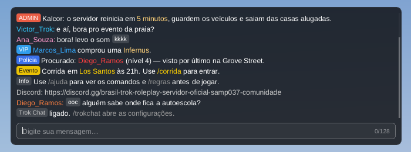
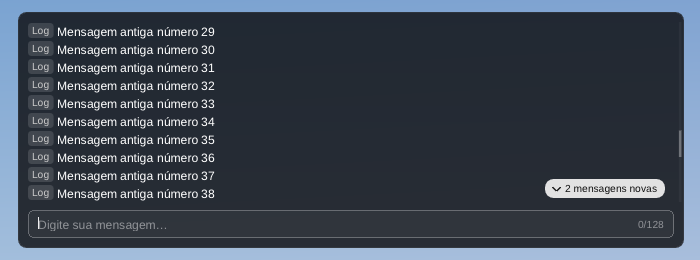
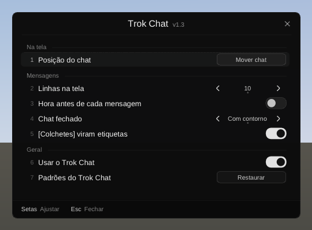
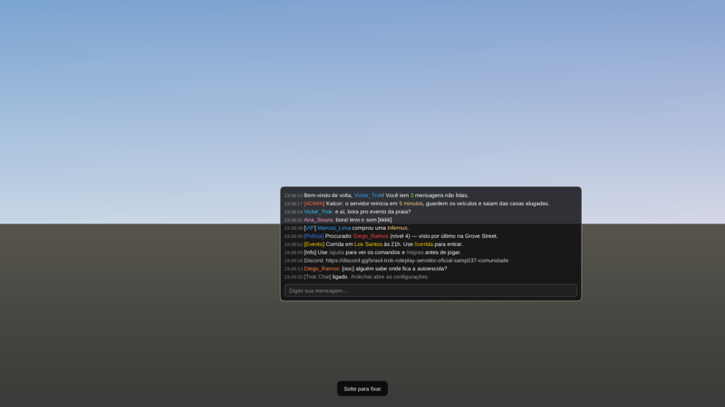

# Trok Chat — o chat do SA-MP com a cara dos menus da casa

Um `.asi` que troca o chat do SA-MP 0.3.7 R1 por um feito com o Dear ImGui e o kit do Trok UI. As mensagens continuam vindo do SA-MP, e o que você digita sai pela caixa dele (comandos do cliente, do servidor, de scripts e dos mods, tudo como antes). Na tela fica **só o conteúdo do Trok Chat**: nem o chat nem a caixa de digitação do SA-MP aparecem, nem quando um script abre o chat.

- **Tags:** um `[conteúdo]` curto (até 24 caracteres) vira uma etiqueta na cor que o servidor deu a ele: `[ADMIN]`, `[VIP]`, `[Polícia]`. Branco ou cinza, a etiqueta fica neutra. Um texto entre colchetes maior que isso continua texto.
- **Cores do servidor:** os `{RRGGBB}` valem como no SA-MP, inclusive dentro das tags. O nick de quem fala sai na cor dele.
- **Quebra de linha:** mensagem comprida desce para a linha de baixo em vez de sair da tela. Um link grande demais é partido onde couber.
- **Fechado,** o chat mostra as últimas linhas por cima do jogo, com contorno preto para ler no céu e no chão.
- **Aberto** (T ou F6, como no SA-MP), ganha um painel escuro, barra de rolagem e a barra de digitação:
  - **Rolagem:** Page Up e Page Down, ou a roda do mouse, por até 300 mensagens (o SA-MP guarda 100). Mensagem nova não mexe no que você está lendo; um aviso mostra quantas chegaram ("3 mensagens novas").
  - **Barra de digitação:** "Digite sua mensagem…", como os campos dos menus da casa. Histórico nas setas para cima e para baixo (o rascunho volta no fim), limite de 128 caracteres com contador, colar com Ctrl+V. Enter manda, Esc fecha.
- **Posição:** o chat pode ir para qualquer lugar da tela, arrastado com o mouse (`/trokchat` → Mover chat).
- **/trokchat** abre o menu de configurações (abaixo).

> **Estado:** versão 1.3, compilada e testada sem o jogo. O chat e o menu desenhados em imagens pelo `test/render.sh` passam as 50 conferências dele; no Wine, com um `samp.dll` de mentira nos endereços do R1, o `test/smoke/run.sh` passa as 83 dele. Ainda não rodou no jogo.








## Instalar

Copie `dist/Trok Chat.asi` para a pasta do `gta_sa.exe` (ou `scripts\`), junto com o ASI Loader. Precisa do SA-MP 0.3.7 R1 (no single player ou em outra versão do SA-MP, ele não mexe em nada).

A fonte é a da casa (`moonloader\resource\trok\font.ttf`) se ela estiver na pasta do jogo; se não, a Arial do Windows.

Se algo der errado, o chat do SA-MP volta sozinho: sem o desenho do Trok Chat (o ImGui não subiu, outro mod cortou o `Present`), o SA-MP volta a desenhar o dele. O log fica em `Trok Chat.log`, ao lado do `.asi`.

## Menu do /trokchat

O casco, as linhas e o rodapé dos outros menus da casa, com o cursor do SA-MP (setas e Enter também funcionam).

| Linha | O que faz |
|---|---|
| **Posição do chat** | "Mover chat": o menu some e o chat aparece aberto, com a borda acesa. Arraste com o mouse e solte onde quiser ("Posição salva"); Esc ou o botão direito cancelam. O chat aberto inteiro sempre cabe na tela. |
| **Posição padrão** | Aparece com o chat fora do canto: "Restaurar" volta para o canto de cima. |
| **Linhas na tela** | 5 a 20 (o `/pagesize` do SA-MP, que também continua valendo). |
| **Hora antes de cada mensagem** | O `/timestamp` do SA-MP. |
| **Chat fechado** | Com contorno, Sem contorno ou Escondido (o F7 do SA-MP). Escondido some só com o chat fechado: aberto, as mensagens aparecem. |
| **[Colchetes] viram etiquetas** | Desligado, `[ADMIN]` fica como texto. |
| **Usar o Trok Chat** | Desligado, o chat e a caixa do SA-MP voltam; o `/trokchat` continua abrindo este menu. |
| **Padrões do Trok Chat** | Canto de cima, 10 linhas, sem hora, com contorno e etiquetas (pede confirmação). |

Tudo vale na hora e fica no `Trok Chat.ini`, ao lado do `.asi`, um segundo depois da última mudança (do menu ou do `/pagesize`, `/timestamp` e F7):

```
[TROK_CHAT]
Etiquetas=1
Ligado=1
PosicaoX=-1
PosicaoY=-1
Linhas=10
Hora=0
ModoF7=2
```

`PosicaoX` e `PosicaoY`: o canto de cima à esquerda do chat em fração da tela (`0.5` = no meio, com ponto ou vírgula), então vale em qualquer resolução; `-1` = o canto de sempre. `ModoF7`: 2 com contorno, 1 sem contorno, 0 escondido.

## Teclado

- **T e F6 como no SA-MP.** É o próprio SA-MP que decide abrir o chat, no fim da corrente de janelas: um mod com um campo de texto na frente (um script com janela do moonloader, por exemplo) continua recebendo o "t", e com um diálogo do servidor ou o menu de pausa na tela o chat não abre, como antes. Quando o SA-MP abre a caixa dele, a barra do Trok Chat abre no lugar.
- **Com a barra aberta**, as teclas e os caracteres ficam com ela: o boneco não anda e o Esc não abre o menu de pausa. As teclas F (F7, F8...) continuam com o SA-MP; o F6 fica com a barra. A tecla que abriu a barra, segurada, não fica repetindo nela (o T segurado não vira "ttt"). As teclas soltas sempre passam, para nada ficar preso no jogo.
- **Enter:** manda a mensagem. Segurado depois de mandar, não chega ao jogo (o boneco não entra no carro); solto e apertado de novo, volta a ser do jogo.
- **"Chat aberto":** enquanto a barra está aberta, o SA-MP fica sabendo (o mesmo campo que a caixa dele usa), então os scripts e os mods que esperam o chat fechar para usar teclas continuam funcionando.
- **Scripts:** abrir o chat (`sampSetChatInputEnabled`) abre a barra do Trok Chat, com o texto que o script pôs na caixa do SA-MP (`sampSetChatInputText`, como um `/r `). Fechar o chat fecha a barra.
- **Sem cursor na barra:** a câmera continua com o mouse enquanto você digita, como no SA-MP. O cursor só aparece no menu.

## Como funciona

Endereços do `samp.dll` 0.3.7 R1 (da [SAMP-API](https://github.com/kin4stat/SAMP-API), licença MIT) e do `gta_sa.exe` 1.0 US.

- **Mensagens:** `CChat::AddEntry` (`0x64010`) desviado com o MinHook. O original continua guardando as 100 dele e escrevendo o `chatlog.txt`; o Trok Chat guarda uma cópia, convertida da página de código do Windows (cp1252 no Brasil) para UTF-8. Ao ligar, copia as que já estavam no chat (`CChat::m_entry`, `+0x132`).
- **Desenho do SA-MP:** `CChat::Draw` (`0x64230`) e `CChat::Render` (`0x63D70`) pulados enquanto o Trok Chat está no lugar e desenhando. Se o SA-MP chamar o `Draw` 30 vezes sem um quadro do Trok Chat no meio, o dele volta até o Trok Chat voltar.
- **Abrir e fechar:** `CInput::Open` (`0x657E0`) e `CInput::Close` (`0x658E0`) desviados. Qualquer pedido de abrir o chat (o T e o F6 do SA-MP, um script) abre a barra; o texto de um script sai da caixa do SA-MP (`CInput::m_pEditbox`, `+0x8`: o `CDXUTEditBox`, conferido pelo tipo do controle em `+0x30` e lido do buffer em `+0x50`), e a caixa fica vazia. O "chat aberto" é o `CInput::m_bEnabled` (`+0x14E0`).
- **Mandar:** `CInput::Send` (`0x65C60`), o mesmo que a caixa do SA-MP usa, com o texto convertido de volta para a página de código do Windows.
- **Configurações do SA-MP:** lidas e escritas no `CChat`: `m_nPageSize` (`+0x0`), `m_nMode` (`+0x8`, o F7), `m_bTimestamps` (`+0xC`) e `m_bRedraw` (`+0x63DA`, para o chat do SA-MP se redesenhar quando volta). Com um diálogo do servidor na tela (`CDialog`, `+0x28`) ou o menu de pausa (`0xBA67A4`), a barra fecha.
- **Cursor do menu:** `CGame::SetCursorMode` (`0x9BD30`, modo 2) e `CGame::UnlockActorCam` (`0x9BC10`), como nos menus da casa.
- **Roda do mouse:** pela do jogo (`CPad::NewMouseControllerState`, `0xB73418`), que funciona em tela cheia (lá o GTA lê o mouse pelo DirectInput e o Windows nem manda a mensagem da roda); enquanto ela não responder, pela do Windows.
- **Desenho:** o mesmo gancho dos mods da casa (`trok-ui/asi`): `Present` e `Reset` do `d3d9.dll`, lidos do arquivo em disco, desviados com o MinHook; o ImGui desenha no fim de qualquer corrente (proxy do SA-MP, Trok Dialogs, Trok Radar, moonloader).

## Compilar

```
./build.sh
```

Precisa do MinGW i686 (`g++-mingw-w64-i686-posix` e `gcc-mingw-w64-i686-posix`) e do git (o Dear ImGui 1.89.9 e o MinHook vêm do `trok-ui/asi/third_party`, baixados se faltarem). O `.asi` sai em `dist/`.

## Testes (sem o jogo)

```
test/render.sh      # o chat e o menu desenhados em PNG, no Linux
test/smoke/run.sh   # o .asi no Wine, com um samp.dll de mentira
```

O `test/render.sh` roda o `chat.cpp` e o `menu.cpp` com um SA-MP falso e mensagens de um servidor de RP:

- confere a quebra das mensagens em pedaços: tags, cores dentro e fora delas, colchetes grandes ou sem fechar, nick com `:`, etiquetas desligadas;
- abre a barra, digita, manda, cancela, navega no histórico, passa do limite de 128 caracteres, recebe texto de script;
- digita logo depois do T (as letras não podem se perder enquanto a barra pega o teclado);
- rola com Page Up, Page Down e as duas rodas, e confere que mensagem nova não mexe na leitura;
- no menu: muda linhas, hora, chat fechado e etiquetas, restaura os padrões;
- move o chat com o mouse: fica onde foi solto, Esc cancela no meio do arrasto (sem fechar o menu), para na beira da tela com o chat aberto inteiro dentro, "Restaurar" volta para o canto;
- grava as imagens em `test/out/render/`.

O `test/smoke/run.sh` precisa de `wine` (com `wine32`), `xvfb-run` e do MinGW i686. O `fake_gta.exe` deixa os endereços do 1.0 US na própria memória, carrega o `samp.dll` de mentira (`make_fake_samp.py`: os ponteiros e as funções do R1, com três mensagens no chat e a caixa de texto no formato do DXUT) e o `.asi`, e apresenta quadros num device D3D9 de verdade, atrás de um proxy como o do SA-MP. O WndProc da janela faz o papel do SA-MP (abre a caixa com o "t" e o F6) e do jogo; um "mod" com campo de texto fica na frente. Os modos:

- **r1:**
  - o chat do SA-MP some e o do Trok Chat aparece, com as mensagens que já estavam lá;
  - o `AddEntry` desviado chama o original e devolve a pilha certa;
  - T e F6 abrem a barra no lugar da caixa do SA-MP; o T segurado não repete na barra;
  - com a barra aberta o jogo não vê as teclas (só as soltas); Enter manda em cp1252 pelo `CInput::Send`, e o Enter segurado depois não chega ao jogo; Esc fecha;
  - com diálogo o T não abre nada; o "t" do mod fica com ele;
  - script abre a barra com o texto dele (e o próximo sem texto, vazia); script fechando fecha a barra; o menu de pausa fecha a barra;
  - o `/pagesize` vai para o `Trok Chat.ini`;
  - o menu do `/trokchat` abre com o cursor do SA-MP, fica com o T, e Esc devolve o mouse;
  - sem o `Present` do Trok Chat, o chat do SA-MP volta sozinho, e some de novo quando ele volta.
- **desligado** (`Trok Chat.ini` com `Ligado=0`, linhas, hora e F7): o chat e a caixa do SA-MP, com os valores do INI, e o `/trokchat` continua abrindo o menu.
- **posicao** (`Trok Chat.ini` com `PosicaoX=0,5` e `PosicaoY=0.4`): o chat fechado e o aberto no meio da tela, nada no canto de sempre.
- **outra-versao:** um `samp.dll` de outra versão: nada muda.
- **sem-samp:** sem o SA-MP: nada muda.

## Versões

- **1.3** — Mover o chat: `/trokchat` → Mover chat, arrastado com o mouse (como o "Mover lista" da Kill List), guardado no `Trok Chat.ini` em fração da tela.
- **1.2** — T e F6 de volta como no SA-MP: a troca das teclas do chat saiu (por enquanto). O Enter segurado depois de mandar continua sem chegar ao jogo.
- **1.1**
  - Só o conteúdo do Trok Chat na tela: script abrindo o chat abre a barra (com o texto pronto dele), não a caixa do SA-MP.
  - Menu do `/trokchat` (antes ele trocava para o chat do SA-MP): linhas, hora, contorno, etiquetas e o Trok Chat ligado ou não, guardados no `Trok Chat.ini`. Tinha também a troca das duas teclas do chat.
  - A barra diz "Digite sua mensagem…" e tem a moldura dos campos da casa. Escondido (F7) some só com o chat fechado.
- **1.0** — primeira versão.

## Créditos

- Endereços e estruturas do SA-MP 0.3.7 R1: SAMP-API (LUCHARE e BlastHack Team; o fork do kin4stat), licença MIT.
- Nomes e estruturas do jogo: gta-reversed e plugin-sdk.
- Dear ImGui (Omar Cornut) e MinHook (Tsuda Kageyu).
