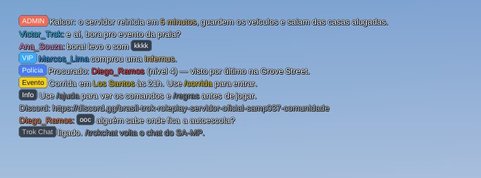
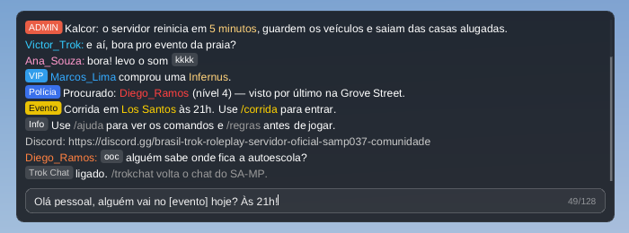
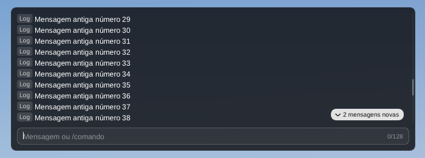
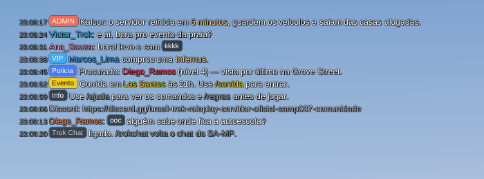

# Trok Chat — o chat do SA-MP com a cara dos menus da casa

Um `.asi` que troca o desenho do chat do SA-MP 0.3.7 R1 por um feito com o Dear ImGui e o kit do Trok UI. As mensagens continuam vindo do SA-MP, e o que você digita sai pela caixa dele (comandos do cliente, do servidor, de scripts e dos mods, tudo como antes). Muda o que aparece na tela:

- **Tags:** um `[conteúdo]` curto (até 24 caracteres) vira uma etiqueta na cor que o servidor deu a ele: `[ADMIN]`, `[VIP]`, `[Polícia]`. Branco ou cinza, a etiqueta fica neutra. Um texto entre colchetes maior que isso continua texto.
- **Cores do servidor:** os `{RRGGBB}` valem como no SA-MP, inclusive dentro das tags. O nick de quem fala sai na cor dele.
- **Quebra de linha:** mensagem comprida desce para a linha de baixo em vez de sair da tela. Um link grande demais é partido onde couber.
- **Fechado,** o chat mostra as últimas linhas por cima do jogo, com contorno preto para ler no céu e no chão.
- **Aberto** (T ou F6), ganha um painel escuro, barra de rolagem e a barra de digitação:
  - **Rolagem:** Page Up e Page Down, ou a roda do mouse, por até 300 mensagens (o SA-MP guarda 100). Mensagem nova não mexe no que você está lendo; um aviso mostra quantas chegaram ("3 mensagens novas").
  - **Barra de digitação:** histórico nas setas para cima e para baixo (o rascunho volta no fim), limite de 128 caracteres com contador, colar com Ctrl+V. Enter manda, Esc fecha.
- **O que já era do SA-MP continua valendo:** `/pagesize` (linhas na tela), `/timestamp` (hora antes de cada mensagem), F7 (com contorno, sem contorno, desligado), o `chatlog.txt`.

**/trokchat** troca entre o Trok Chat e o chat do SA-MP, na hora.

> **Estado:** versão 1.0, compilada e testada sem o jogo. O chat desenhado em imagens pelo `test/render.sh` passa as 33 conferências dele; no Wine, com um `samp.dll` de mentira nos endereços do R1, o `test/smoke/run.sh` passa as 56 dele. Ainda não rodou no jogo.






## Instalar

Copie `dist/Trok Chat.asi` para a pasta do `gta_sa.exe` (ou `scripts\`), junto com o ASI Loader. Precisa do SA-MP 0.3.7 R1 (no single player ou em outra versão do SA-MP, ele não mexe em nada).

A fonte é a da casa (`moonloader\resource\trok\font.ttf`) se ela estiver na pasta do jogo; se não, a Arial do Windows.

Se algo der errado, o chat do SA-MP volta sozinho: sem o desenho do Trok Chat (o ImGui não subiu, outro mod cortou o `Present`), o SA-MP volta a desenhar o dele. O log fica em `Trok Chat.log`, ao lado do `.asi`.

## Teclado

- **T e F6** fazem o caminho de sempre até o SA-MP. Quando o SA-MP abre a caixa dele por causa deles, a barra do Trok Chat abre no lugar. Por isso um mod com um campo de texto na frente (um script com janela do moonloader, por exemplo) continua recebendo o "t", e com um diálogo do servidor na tela o chat não abre, como antes.
- **Com a barra aberta**, as teclas e os caracteres ficam com ela: o boneco não anda e o Esc não abre o menu de pausa. As teclas F (F7, F8...) continuam com o SA-MP. As teclas soltas sempre passam, para nada ficar preso no jogo.
- **"Chat aberto":** enquanto a barra está aberta, o SA-MP fica sabendo (o mesmo campo que a caixa dele usa), então os scripts e os mods que esperam o chat fechar para usar teclas continuam funcionando.
- **Script abrindo o chat** (com um texto pronto, como um `/r `): abre a caixa do SA-MP mesmo, para o texto dele aparecer. Script fechando o chat fecha a barra.
- **Sem cursor:** a câmera continua com o mouse enquanto você digita, como no SA-MP.

## Como funciona

Endereços do `samp.dll` 0.3.7 R1 (da [SAMP-API](https://github.com/kin4stat/SAMP-API), licença MIT) e do `gta_sa.exe` 1.0 US.

- **Mensagens:** `CChat::AddEntry` (`0x64010`) desviado com o MinHook. O original continua guardando as 100 dele e escrevendo o `chatlog.txt`; o Trok Chat guarda uma cópia, convertida da página de código do Windows (cp1252 no Brasil) para UTF-8. Ao ligar, copia as que já estavam no chat (`CChat::m_entry`, `+0x132`).
- **Desenho do SA-MP:** `CChat::Draw` (`0x64230`) e `CChat::Render` (`0x63D70`) pulados enquanto o Trok Chat está no lugar e desenhando. Se o SA-MP chamar o `Draw` 30 vezes sem um quadro do Trok Chat no meio, o dele volta até o Trok Chat voltar.
- **Abrir e fechar:** `CInput::Open` (`0x657E0`) e `CInput::Close` (`0x658E0`) desviados. Aberto enquanto a janela passa o T ou o F6 adiante, abre a barra no lugar; aberto de outro jeito, abre a caixa do SA-MP. O "chat aberto" é o `CInput::m_bEnabled` (`+0x14E0`).
- **Mandar:** `CInput::Send` (`0x65C60`), o mesmo que a caixa do SA-MP usa, com o texto convertido de volta para a página de código do Windows.
- **Configurações do SA-MP:** lidas a cada quadro do `CChat`: `m_nPageSize` (`+0x0`), `m_nMode` (`+0x8`, o F7) e `m_bTimestamps` (`+0xC`). Com um diálogo do servidor na tela (`CDialog`, `+0x28`) ou o menu de pausa (`0xBA67A4`), a barra fecha.
- **Roda do mouse:** pela do jogo (`CPad::NewMouseControllerState`, `0xB73418`), que funciona em tela cheia (lá o GTA lê o mouse pelo DirectInput e o Windows nem manda a mensagem da roda); enquanto ela não responder, pela do Windows.
- **Desenho:** o mesmo gancho dos mods da casa (`trok-ui/asi`): `Present` e `Reset` do `d3d9.dll`, lidos do arquivo em disco, desviados com o MinHook; o ImGui desenha no fim de qualquer corrente (proxy do SA-MP, Trok Dialogs, Trok Radar, moonloader).

## Compilar

```
./build.sh
```

Precisa do MinGW i686 (`g++-mingw-w64-i686-posix` e `gcc-mingw-w64-i686-posix`) e do git (o Dear ImGui 1.89.9 e o MinHook vêm do `trok-ui/asi/third_party`, baixados se faltarem). O `.asi` sai em `dist/`.

## Testes (sem o jogo)

```
test/render.sh      # o chat desenhado em PNG, no Linux
test/smoke/run.sh   # o .asi no Wine, com um samp.dll de mentira
```

O `test/render.sh` roda o `chat.cpp` com um SA-MP falso e mensagens de um servidor de RP:

- confere a quebra das mensagens em pedaços: tags, cores dentro e fora delas, colchetes grandes ou sem fechar, nick com `:`;
- abre a barra, digita, manda, cancela, navega no histórico, passa do limite de 128 caracteres;
- digita logo depois do T (as letras não podem se perder enquanto a barra pega o teclado);
- rola com Page Up, Page Down e as duas rodas, e confere que mensagem nova não mexe na leitura;
- grava as imagens em `test/out/render/`.

O `test/smoke/run.sh` precisa de `wine` (com `wine32`), `xvfb-run` e do MinGW i686. O `fake_gta.exe` deixa os endereços do 1.0 US na própria memória, carrega o `samp.dll` de mentira (`make_fake_samp.py`: os ponteiros e as funções do R1, com três mensagens no chat) e o `.asi`, e apresenta quadros num device D3D9 de verdade, atrás de um proxy como o do SA-MP. O WndProc da janela faz o papel do SA-MP (abre a caixa com o "t" e o F6) e um "mod" com campo de texto fica na frente dele. Os modos:

- **r1:**
  - o chat do SA-MP some e o do Trok Chat aparece, com as mensagens que já estavam lá;
  - o `AddEntry` desviado chama o original e devolve a pilha certa;
  - T e F6 abrem a barra no lugar da caixa do SA-MP; com ela aberta o jogo não vê as teclas, só as soltas;
  - Enter manda o texto em cp1252 pelo `CInput::Send`, e Esc fecha sem mandar;
  - com diálogo o T não abre nada; o "t" do mod fica com ele;
  - script abre a caixa do SA-MP; script fechando fecha a barra; o menu de pausa fecha a barra;
  - `/trokchat` troca nos dois sentidos;
  - sem o `Present` do Trok Chat, o chat do SA-MP volta sozinho, e some de novo quando ele volta.
- **outra-versao:** um `samp.dll` de outra versão: nada muda (o T abre a caixa do SA-MP, o chat dele continua).
- **sem-samp:** sem o SA-MP: nada muda.

## Créditos

- Endereços e estruturas do SA-MP 0.3.7 R1: SAMP-API (LUCHARE e BlastHack Team; o fork do kin4stat), licença MIT.
- Nomes e estruturas do jogo: gta-reversed e plugin-sdk.
- Dear ImGui (Omar Cornut) e MinHook (Tsuda Kageyu).
