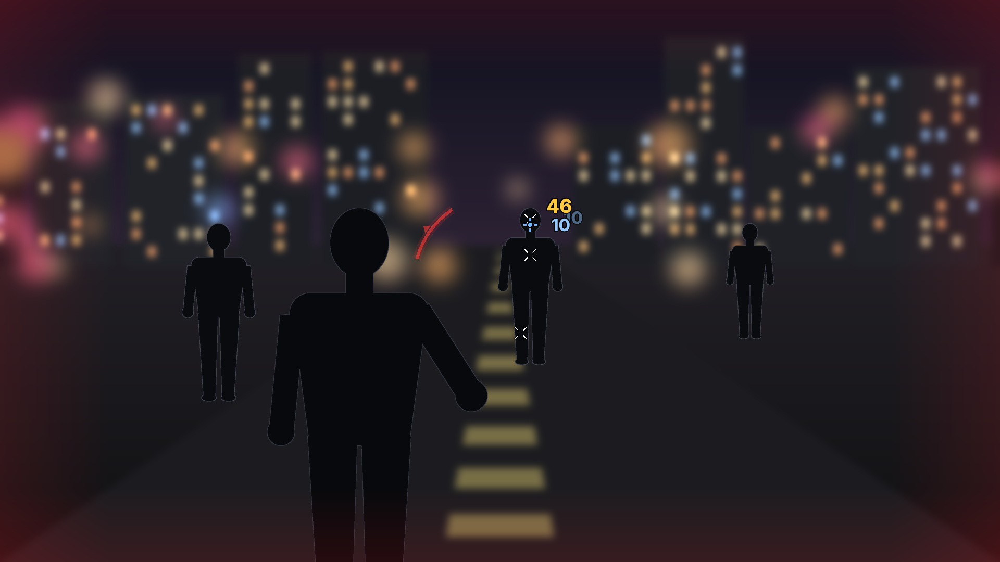
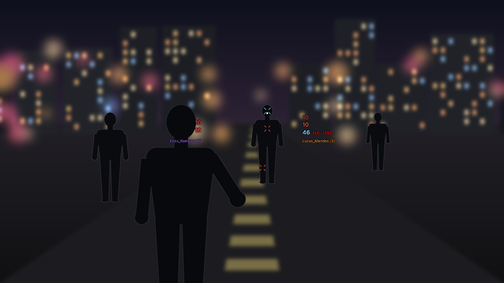

# Trok Hitmarker

Indicador de dano para o SA-MP 0.3.7 R1, no estilo da casa: sinal de acerto na mira, local do acerto marcado no corpo, números de dano real, o informer com nome e combo, seta de onde veio o tiro levado, borda de dano recebido e sons trocáveis. Cada parte liga e desliga sozinha, e as que fazem sentido juntas podem ficar juntas. Menu: `/trokhit`.

**Estado:** v1.1, `.asi` compilado e testado fora do jogo (Wine, com um GTA e um samp.dll de mentira: `test/smoke/run.sh`, 8 cenários, entre eles uma troca de tiros simulada com 20 jogadores). Falta o teste no jogo de verdade.

| | |
|---|---|
|  |  |
| Estilo Trok: sinal na mira, marcas no corpo, números saindo do alvo, seta de onde veio o tiro | Estilo Damage Informer: nick parado e número subindo, simétrico ao centro, com o dano real e o combo somando |

## Instalar

1. Copie `dist/Trok Hitmarker.asi` para a pasta do GTA (a mesma dos outros `.asi`; precisa do ASI Loader).
2. Se quiser já começar com as imagens e os sons para editar, copie também a pasta `dist/Trok Hitmarker` para o mesmo lugar. Sem ela, o mod cria a pasta na primeira vez com os padrões.
3. Entre num servidor e digite `/trokhit`.

Precisa do `gta_sa.exe` 1.0 US e do SA-MP 0.3.7 R1; em outra versão o mod fica desligado sem mexer em nada (o `Trok Hitmarker.log` diz o motivo). As escolhas ficam no `Trok Hitmarker.ini`, por servidor (`[padrao]` e uma seção `ip:porta`), gravadas um instante depois da última mudança no menu.

**Arquivos ao lado do `.asi`:**

| | |
|---|---|
| `Trok Hitmarker.ini` | as opções (criado na primeira mudança no menu) |
| `Trok Hitmarker.log` | o que o mod fez nesta sessão: versões conferidas, ganchos, imagens e sons carregados e os primeiros acertos com o dano do GTA e o real (para conferir no seu servidor) |
| `Trok Hitmarker\mira\` | `mira.png`, `acerto.png`, `colete.png`, `cabeca.png`, `abate.png`, `corpo.png` |
| `Trok Hitmarker\sons\` | `acerto`, `cabeca`, `dano_levado`, `abate`, `abate_cabeca`, `morte` (`.mp3` ou `.wav`) |

## O que o projeto antigo faz (e o que muda)

- **`damage-indicator-samp.lua`**: lê o pacote de dano que o seu SA-MP manda ao servidor (RPC 115) e mostra o número dele, `46.2`. Esse é o valor que o GTA calcula para a arma, não o que o servidor tirou: em servidor com dano de arma configurado, colete ou headshot que mata de uma vez, o número não bate. O combo `(x3)` conta tiros, não soma dano, e cada informer guarda um tiro só (com a M4, o tiro novo apaga o anterior).
- **`hitmarker.lua`**: o X (`hitmarker.txd`) no osso do corpo onde o tiro pegou. A duração é em quadros (28), então muda com o FPS: uns 0,47 s a 60 FPS e 0,2 s a 144 FPS.
- **`Take Damage Notification.lua`**: escreve cada acerto no chat (jogador, arma, parte do corpo e o mesmo `46.2`).

**No Trok Hitmarker:** o acerto continua vindo do pacote do SA-MP (é na hora e diz quem, arma e parte do corpo), mas o número é a **vida + colete que o alvo perdeu de verdade**, lidos do sync dele logo depois do tiro. Assim vale a regra de cada servidor sozinha: dano de arma configurado, colete, HS sem capacete que mata em 1. Se o servidor esconde a vida (o alvo não mostra a perda), aparece o número do GTA com um `~` na frente. O combo do informer soma o dano real no mesmo alvo. Tudo é medido em tempo, não em quadros.

## Mira, corpo e centro da tela

Só o sinal de acerto acompanha a mira. O resto fica preso à tela: a seta de onde veio o tiro gira em volta do centro, o informer fica dos dois lados do centro (dado à direita, levado à esquerda) e os números "na tela" sobem do lado do centro. O botão **Mover** (abas Informer e Geral) mostra as duas caixas do informer com um exemplo dentro: arraste cada uma, Enter salva, Esc ou o botão direito desiste (`docs/09-mover.png`).

- **Mira:** a do jogo ou a **do Trok** (a Mira Centralizada refeita: a imagem `mira.png`). Um tamanho só vale para a mira e para tudo que aparece nela. A do Trok pode ficar **sempre visível** (também sem mirar, a pé; some no carro e com sniper, bazuca e lança-mísseis, como no script original), e o GTA não desenha a mira dele. A do jogo pode ficar **estática** (não abre enquanto você atira; muda só o desenho, o espalhamento dos tiros continua o do jogo).
- **Uma imagem para cada coisa, sem estilos no código:** `mira.png`, `acerto.png`, `colete.png`, `cabeca.png`, `abate.png` e `corpo.png` (o X do local do acerto), na pasta `Trok Hitmarker\mira`. O visual é o da imagem: quer outro, edite o PNG (apagou, volta o padrão que vem no `.asi`). A imagem inteira ocupa o tamanho da mira (40 px numa tela de 1080, vezes o Tamanho; o corpo, 48 px), então qualquer resolução serve. O mod só faz o pulo (35% maior, voltando em 0,1 s), o tempo (acerto 0,35 s, cabeça 0,55 s, abate 1,2 s, em qualquer FPS) e o sumir. O efeito fica no lugar da mira enquanto aparece, por isso as imagens de efeito já trazem o ponto (`docs/04-hitmarker.png`; as padrão saem de `res/make_images.py`).
- **O que aparece:** acerto, colete, cabeça e abate ligam e desligam um por um. Colete, cabeça ou abate desligados mostram a imagem do acerto naquele tiro.
- **Onde:** desenhado onde a mira está naquele quadro. O mod lê onde o próprio GTA desenhou a mira, então mod que centraliza ou sobe a mira não precisa de ajuste nem de opção no menu (`docs/08-mira-seguida.png`).
- **Local do acerto:** o `corpo.png` fica na parte do corpo que o tiro pegou (cabeça, tronco, braço, perna) por 1 a 5 s, acompanhando o alvo quando ele anda (`docs/06-local-do-acerto.png`).

## Animações

O sinal na mira tem cinco animações, e os números de dano quatro. A imagem continua sendo a da pasta; muda só o movimento. No menu, a prévia no alto das abas Mira e Dano repete a animação escolhida.

- **Sinal:** Pulo (cresce e volta), Expandir (nasce menor e abre para fora enquanto some, como o anel em volta da mira do Fortnite), Soco (entra grande e torto e assenta num tranco), Giro (gira 45 graus) e Nenhuma (`docs/19-animacao-sinal.gif`).
- **Números:** Subir (o damage informer antigo), Arco (estoura grande, assenta com um repique e sai num arco para o lado, como no Fortnite), Saltar (pula e volta) e Parado (`docs/20-animacao-numeros.gif`).

## Cor pela vida

Opção nas abas Dano e Informer: o número começa branco com a vida cheia e vai para o amarelo, o laranja e o vermelho conforme a vida cai. No dano que você dá conta a vida do oponente; no que você leva (informer), a sua. O abate continua vermelho (`docs/22-cor-pela-vida.png`).

## Somando

Um número só por alvo, que vai crescendo a cada acerto, de qualquer arma, até você ficar o tempo escolhido (1 a 5 s) sem acertar. É como o dano cumulativo do Fortnite. **Separar a cabeça:** o dano na cabeça cresce num número dourado próprio, em cima do outro. Na tela (em vez de no personagem), é um número só para todos os alvos.

O informer clássico tem a mesma escolha: **Combo** (cada acerto sobe com o seu número e o `(x3 · 138)` ao lado) ou **Somando** (um número só em cima do nick, com a cabeça ao lado em dourado se estiver separada) (`docs/21-informer-somando.png`).

## Dano real numa troca de tiros com muita gente

- **Cada alvo tem a sua conta** (pelo id do SA-MP): tiros em pessoas diferentes nunca se misturam.
- **Outras pessoas acertando o mesmo alvo:** o mod lê o bullet sync do SA-MP (a bala dos outros jogadores, com a arma). Com isso ele sabe quanto cada bala costuma tirar naquele servidor e separa a queda de vida do alvo em "sua" e "dos outros". Soco ou explosão (sem bala) aparecem como queda sem tiro de ninguém, e aí o seu tiro vale o que a sua arma costuma tirar.
- **Quanto cada arma tira no servidor:** o mod aprende com os tiros que caem sozinhos, seus ou dos outros, pela mediana; um tiro misturado não estraga a conta. Também aprende se o headshot de uma arma mata de uma vez.
- **Abate:** quem decide é o servidor, pela mensagem de morte com o seu nick como matador. Quando a vida zera com tiro seu ainda no ar, o mod espera essa mensagem. Se a morte foi de outro, o tiro que chegou com o alvo morto não vira número. Em servidor que não manda mensagem de morte, vale a ordem das balas; na dúvida (bala de outro chegando quase junto), o mod não conta o abate.
- **Tempo de espera:** acompanha o ping medido (0,8 a 2 s). Sem queda de vida nesse tempo, vale o número do GTA com `~`.
- **Conferir no seu servidor:** ligue "Anotar todos os acertos no log" (aba Geral). O `Trok Hitmarker.log` passa a anotar cada acerto com o dano do GTA e o real, ou "alvo disputado" quando outra pessoa também acertava.

Teste `pvp-20`: troca de tiros simulada com 20 jogadores num servidor com dano próprio (Deagle 70, M4 13, Sniper 90; headshot de Deagle ou Sniper mata) e ping de 80 a 300 ms. Você atira em rajadas trocando de alvo, e 6 outros atiradores acertam os mesmos alvos (metade das balas deles no seu alvo), com e sem bullet sync. Em 4 sementes diferentes, com mensagem de morte, os resultados foram:

- **Abates:** todos os seus contados e nenhum dos outros contado como seu.
- **Números:** 87 a 95% dentro de ±5 do dano que o servidor aplicou.
- **O que sobra:** o começo da troca, antes de o mod aprender quanto cada arma tira, e balas suas e de outros de mesmo valor chegando juntas.

Sem mensagem de morte (`pvp-20-sem-mensagem`), quem matou é uma estimativa pela ordem das balas. Nas mesmas sementes, de 7 a 16 abates seus por troca, o mod contou de 0 a 2 abates a mais e perdeu de 1 a 4.

## Dano recebido

- **Seta de onde veio o tiro:** sempre vermelha, em volta do centro da tela, apontando para quem atirou (em cima = pela frente, embaixo = por trás). Gira junto quando você vira a câmera.
- **Borda de dano recebido:** as bordas da tela piscam na cor do que foi atingido: vida (vermelho), colete (preto) ou cabeça (azul). As três cores mudam no menu (`docs/15-borda.png`).

## Sons

Pasta `Trok Hitmarker\sons`, ao lado do `.asi`, com `.mp3` ou `.wav` destes nomes: `acerto`, `cabeca` (no lugar do acerto quando o tiro pega na cabeça, se "Som diferente na cabeça" estiver ligado), `dano_levado`, `abate`, `abate_cabeca` e `morte`. Se tiver os dois, vale o `.mp3`. Trocou ou apagou o arquivo, vale em até um segundo, sem reiniciar o jogo (apagou: volta o padrão). Os padrões foram sintetizados para o mod (`res/make_sounds.py`, nada copiado de outro jogo). Tocam pelo DirectSound do Windows, vários ao mesmo tempo, com o volume do menu; com o jogo minimizado ficam mudos.

## Como funciona por dentro

- **Acertos** (`src/samp.cpp`): ganchos no `CLocalPlayer::SendGiveDamage` e `SendTakeDamage` do samp.dll R1 (o mesmo pacote que o damage informer antigo lia), na mensagem de morte (`CDeathWindow::AddMessage`) e no bullet sync dos outros jogadores (`CRemotePlayer::Update(BulletData*)`). Os ganchos só avisam: o pacote segue para o servidor como sempre.
- **Dano real** (`src/logic.cpp`): a cada tiro, a vida + colete do sync do alvo antes; a queda que chega depois é o dano. Tiros que chegam juntos dividem a queda pelo que cada um costuma tirar (o mod aprende a proporção de cada arma com os tiros sozinhos). Sem queda em 1 s, vale o número do GTA com `~`. Abate: a mensagem de morte com o seu nick, ou a vida do alvo zerando depois de um tiro seu (conta uma vez só).
- **Mira** (`src/game.cpp`): ganchos no `CHud::DrawCrossHairs`, `CSprite2d::Draw`/`DrawRect` e `CPlayerPed::GetWeaponRadiusOnScreen` do 1.0 US. O mod lê onde o GTA desenha a mira em cada quadro (por isso segue mods que mexem nela); com a mira do Trok, os quartos da mira do jogo não chegam a ser desenhados; a estática zera o contador de tiros só durante o desenho; o tamanho da mira do jogo escala os retângulos dela. Se o desenho do mod parar, a mira do jogo volta sozinha em meio segundo.
- **Desenho** (`src/hud.cpp`, `src/menu.cpp`): Dear ImGui no Present do d3d9, como os outros mods da casa (`src/main.cpp`). Imagens (`src/images.cpp`, stb_image) viram texturas do D3D9; imagem grande é reduzida até 256 px.

## Compilar e testar

- `./build.sh`: MinGW i686, usa o kit da casa e o ImGui/MinHook da vitrine (`../trok-ui/asi`). As imagens e os sons de `dist/Trok Hitmarker` entram no `.asi` (`res/embed.py`).
- `test/smoke/run.sh`: Wine 32 bits + Xvfb. Cenários: `trok` (mira do Trok, acerto, número, local do acerto, abate, dano levado com seta e borda, dano sem queda de vida, menu e gravação do INI), `mira-do-jogo` (estática e 150%), `pasta-propria` (mp3, PNG retangular, troca da mira com o jogo rodando), `desligado`, `outra-versao`, `gta-errado`, `pvp-20` e `pvp-20-sem-mensagem` (a troca de tiros com 20; `PVP_SEED=n` muda a semente, `PVP_DETALHE=1` lista os números que erraram).
- `test/concept.sh`: as imagens de `docs/`, do código de desenho de verdade rasterizado no Linux.

Bibliotecas de terceiros em `third_party/`: minimp3 (CC0) e stb_image (domínio público/MIT).

## Imagens

`docs/04-hitmarker.png` (as imagens e a animação), `05-numeros.png`, `06-local-do-acerto.png`, `03-informer-lista.png`, `07-recebido.png`, `15-borda.png`, `08-mira-seguida.png`, `09-mover.png`, `10`–`18` (menu), `19-animacao-sinal.gif`, `20-animacao-numeros.gif`, `21-informer-somando.png` e `22-cor-pela-vida.png`.
