# Trok KeyBinder

Binds para o SA-MP 0.3.7 R1 no estilo da casa. Uma tecla, uma condição ou o jogador na sua frente mandam um comando ou uma frase no chat. Cada servidor tem o seu preset.

Classes de bind, uma aba cada:

- **Padrão:** uma tecla manda o texto.
- **Automático:** a bind dispara sozinha numa condição (entrar no carro, vida baixa, mensagem no chat...).
- **Ao redor:** usa o jogador perto de você, com o `(id)` e o `(nick)` dele.
- **Na visão:** usa o jogador na sua mira. Uma lista presa nele mostra as binds.
- **Macro:** em breve (o plano está em [MACRO.md](MACRO.md)).

**Estado:** v0.2, `.asi` compilado e testado fora do jogo:
- **No Wine** (`test/smoke/run.sh`): um GTA e um samp.dll de mentira recebem teclas de verdade na janela, e o teste confere cada mensagem que o mod manda pelo `CInput::Send`. São 43 conferências em 2 cenários.
- **No Linux:**
  - `test/run.sh`: o motor, os presets e a pasta (99 conferências);
  - o menu, o círculo e a lista desenhados em imagens (28 conferências).

**Novo na v0.2:**
- **A pasta `Trok KeyBinder`:** um arquivo por preset, para copiar e passar a alguém. O `Trok KeyBinder.txt` da v0.1 passa para ela sozinho.
- **Anti-flood por preset** (cada servidor com o seu limite).
- **Mensagem no chat:** só mensagens do servidor contam, e a fala repassada ("Fulano diz: ...") fica de fora.
- **Vale:** sempre, só no veículo ou só a pé (a tecla e o menu).
- **Grupos no círculo** e a **posição** de cada bind no menu.
- **Botão do meio e laterais do mouse** (Mouse 4 e 5) como tecla.
- **Busca** nas abas das binds.
- **A roda do mouse** anda pelas fatias do círculo e pelos itens da lista.

Falta o teste no jogo de verdade.

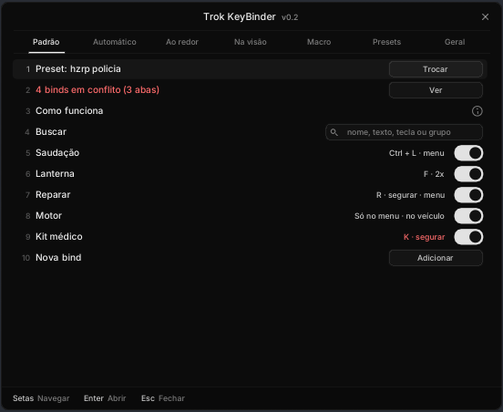
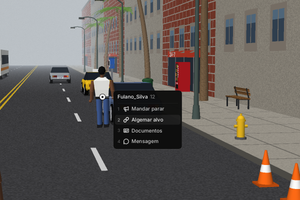

## Instalar

1. Copie `dist/Trok KeyBinder.asi` para a pasta do GTA (a mesma dos outros `.asi`; precisa do ASI Loader).
2. Abra o jogo e entre no servidor. A pasta `Trok KeyBinder` nasce sozinha ao lado do `.asi` (veja "A pasta", no fim).

Precisa do `gta_sa.exe` 1.0 US e do SA-MP 0.3.7 R1. Em outra versão o mod fica desligado sem mexer em nada, e o `Trok KeyBinder\Trok KeyBinder.log` diz o motivo.

## Abrir

Digite **`/trokbinder`** no chat.

- **Setas** e **Enter** andam e abrem.
- **O número de uma linha (1-9)** leva até ela e, numa linha de bind, abre a bind. Só as linhas que fazem alguma coisa têm número; avisos e dados (o endereço do servidor, os "bloqueado" do Geral) ficam sem número e as setas passam direto por eles.
- **Esc** volta do editor e fecha o menu.

No editor, **Ctrl+S** salva.

## Nunca dispara com

Nenhuma bind de tecla dispara com estas coisas abertas:
- o chat (o do SA-MP ou a barra do Trok Chat), e por mais 150 ms depois de ele fechar;
- um diálogo do servidor;
- o placar (Tab);
- o menu de pausa;
- este menu;
- o menu de outro mod que mostra o cursor do SA-MP.

As automáticas que caem nesse momento **esperam** fechar (até 15 s).

**Anti-flood:** nada sai de uma vez. As mensagens vão numa fila, uma a cada **1,2 s**. O intervalo é de cada preset (aba Presets), porque cada servidor tem o seu limite. Uma bind com várias linhas manda uma mensagem por linha.

## Padrão

- **Tecla:** uma tecla, **Ctrl/Shift/Alt + tecla**, o **botão do meio** do mouse (clicar a bolinha) ou os **laterais** (Mouse 4 e 5). Clique no campo e aperte o atalho; Backspace limpa.
- **Ao apertar:**
  - **Pressionar**;
  - **Segurar** (2 s, ajustável no Geral);
  - **2x seguidas** (até 350 ms entre os toques).
- **Texto:** comando ou frase, uma mensagem por linha. Passou de 128 letras? O editor avisa (o SA-MP corta).
- **Vale:** sempre, **só no veículo** ou **só a pé**. Fora do lugar dela, a tecla não dispara e a bind some do círculo. Exemplo: trancar, cinto e motor só no carro.
- **Adicionar ao menu de binds:** a bind aparece no círculo. Com ela no menu, a tecla é opcional.
- **Grupo no círculo** (opcional): binds com o mesmo grupo viram uma fatia só (com uma pasta), que abre o círculo do grupo. Exemplo: "Polícia" com algemar, revistar e multar.
- **Posição no círculo:** a ordem das binds no círculo (ou na lista da visão), entre as do mesmo grupo.

A **busca**, no topo de cada aba, filtra as binds pelo nome, texto, tecla ou grupo.

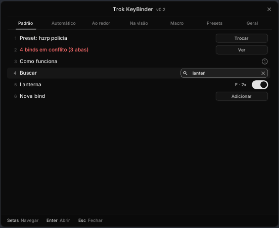
- **Nome:** o que aparece no círculo e na lista. Vazio, vira a primeira linha do texto.
- **Ícone:** aparece no círculo e na lista (abaixo).

## Automático

| Condição | Detalhe |
|---|---|
| Entrar num veículo | qualquer lugar, motorista ou passageiro |
| Sair do veículo | |
| Vida abaixo de X | uma vez na descida; morrer não conta |
| Colete abaixo de X | |
| Lataria do veículo abaixo de X | 0 a 1000; o carro pega fogo em 250 |
| Nascer (spawn) | |
| Morrer | |
| Sacar uma arma | uma arma certa ou qualquer uma; nascer com ela não conta |
| Entrar num interior / Sair para a rua | |
| Conectar no servidor | |
| **Mensagem no chat** | um trecho do chat dispara a bind (abaixo) |

- **Esperar:** na hora, 0,5 s, 1 s... até 60 s depois da condição.
- **A condição deixou de valer antes do tempo?** A bind não vai. Exemplo: entrou no carro e saiu antes do `/cinto`.
- **Mesma condição e mesmo tempo:** as duas binds ficam **vermelhas** e **não salvam** (nem ligam pelo interruptor), com um aviso dizendo qual é a outra. Exemplo: `/tranca` na hora e `/cinto` 1 s depois.

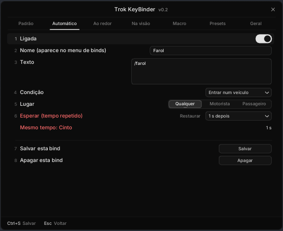

### Mensagem no chat

Exemplo para administradores: o trecho `está precisando de atendimento` dispara `/atender (id)`.

- **O texto é comparado sem cores** `{RRGGBB}` (até no meio de uma palavra: `aten{FF0000}dimento`), sem maiúsculas, sem acentos e sem espaços repetidos.
- **Só mensagens do servidor contam.** A fala dos jogadores nunca dispara, e a sua também não.
- **Ignorar fala de jogador** (ligado): servidores RP costumam repassar a fala local como mensagem deles ("Fulano_Silva diz: ..."). Com um `:` antes do trecho, a linha não conta, então ninguém dispara a sua bind digitando a frase.
- **O `(id)` e o `(nick)` vêm da própria mensagem.** O mod procura, nesta ordem:
  1. o nick de alguém conectado (`Fulano_Silva` ou `Fulano Silva`);
  2. um ID: `(12)`, `[12]`, `ID 12` ou `#12`.
- Se o texto usa `(id)` ou `(nick)` e ninguém é achado, a bind não vai. Aparece um aviso.
- **Esperar entre disparos** (5 s): vários pedidos de uma vez não viram uma enxurrada de comandos.
- **Testar com uma mensagem:** cole uma mensagem do chat e o editor mostra se dispara e o que vai.

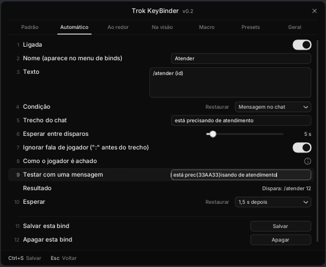

## Ao redor

- **Raio** (1 a 50 m) e **Quem:**
  - **O mais perto**;
  - **Todos no raio** (até 10 por vez, na fila do anti-flood).
- **Tecla:** como no Padrão, e pode ir para o círculo.
- **Ignorar:** a lista dos jogadores por perto, com a distância. Marque quem o mod deve pular. Os ignorados que estão longe continuam na lista para desmarcar.
- **`(id)` e `(nick)`** no texto viram os do jogador (`{id}` e `{nick}` também valem).

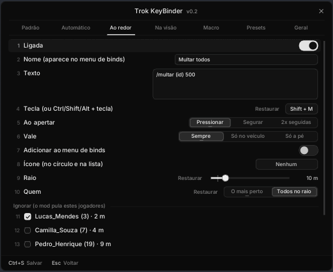

## Na visão

O alvo é o jogador mais perto da **linha do centro da tela**:
- até 25 m (ajustável no Geral);
- sem parede no meio (o mesmo teste de parede do SA-MP).

Uma **bolinha** aparece no meio do corpo dele, só se houver bind da visão.

Com alguém na mira, o atalho do menu de binds abre a **lista presa no jogador**, como nos menus de alvo dos servidores RP de FiveM:
- Ela sai da bolinha, com o nick e o número do ID ao lado (`Fulano_Silva 12`), e **segue o jogador** na tela.
- Cada item tem o número sutil e o ícone da bind.
- **Para rodar uma bind:**
  - clique no item;
  - ou aperte o **número** dele;
  - ou ande com as setas ou a roda do mouse e dê Enter;
  - ou segure o atalho, aponte e solte.
- Se o jogador sumir da visão, a lista fecha.

No Geral dá para trocar a lista pelo círculo. A bind da visão também pode ter uma tecla própria, que usa quem estiver na mira.

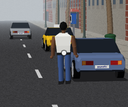

## O menu de binds (círculo)

O atalho fica no Geral (nenhum por padrão).

**Sem ninguém na mira**, o atalho abre o círculo no meio da tela, como o do FiveM, com as binds marcadas "No menu".

- **Para rodar uma bind:**
  - clique na fatia;
  - ou aperte o **número** dela (1-8);
  - ou ande com a **roda do mouse** ou as setas e dê Enter;
  - ou segure o atalho, aponte e solte.
- **Mais de 8 binds:** viram páginas; a roda passa de uma para a outra sozinha.
- **Grupos:** a fatia do grupo abre o círculo dele. Lá, o meio (ou o botão direito) volta.
- **Só o que vale agora:** a pé, as binds "só no veículo" não aparecem (e vice-versa).
- **Fechar:** Esc, botão direito, clique no meio ou o atalho de novo.

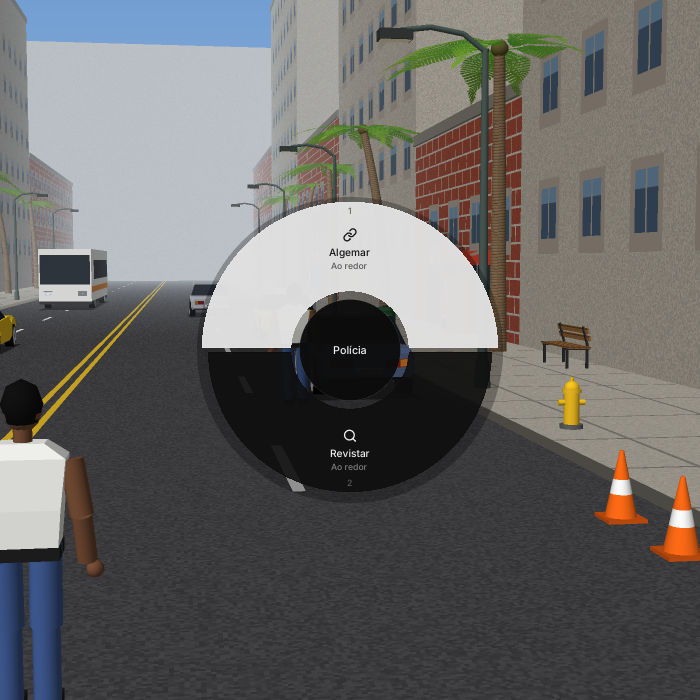

Cada fatia mostra o ícone da bind em cima do nome e o número na borda de fora.

Com o Geral em "Círculo", as binds da visão também entram no círculo quando há alguém na mira (primeiro elas, com `Fulano_Silva 12` no meio).

## Ícones

No editor da bind, **Ícone** abre a grade com 71 ícones do [Lucide](https://lucide.dev) (a família que o kit da casa usa): carro, trancar, chave, algemas, revistar, documento, megafone, lanterna, vida, cruz, telefone, dinheiro... Passe o mouse para ver o nome; a primeira casa tira o ícone.

O `lucide.ttf` da casa é um recorte com poucos ícones, então estes vêm desenhados no próprio mod (traços tirados dos SVG do Lucide por `tools/gen_icons.py`).

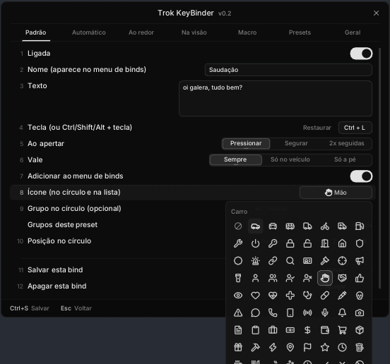

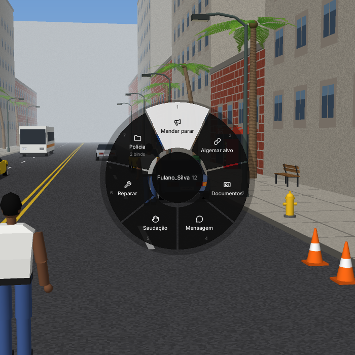

## Conflitos

**A mesma ativação em duas binds** fica vermelha e não salva, em qualquer aba. Exemplo: K na aba Padrão e K na aba Ao redor.

| Combinação na mesma tecla | Conflita? |
|---|---|
| O mesmo modo nas duas | sim |
| Pressionar numa e qualquer modo na outra (o primeiro toque já é um "pressionar") | sim |
| Segurar numa e 2x seguidas na outra | não, os gestos não se misturam |
| Ctrl+K numa e K na outra | não |

- **O atalho do círculo** não pode ser a tecla de uma bind, de nenhum preset.
- **No topo de cada aba**, um aviso diz quantas binds estão em conflito e em quais abas. O botão **Ver** (ou Enter no número dele) abre a próxima bind em conflito, já na aba dela; o editor mostra qual é a outra.

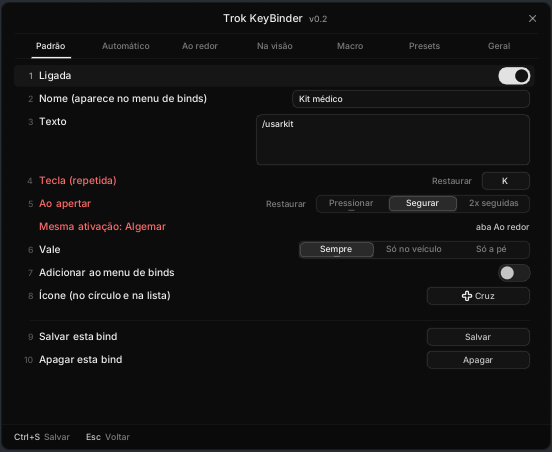

## Presets por servidor

- **Servidor novo:** na primeira entrada, ganha um preset com o nome dele (o hostname, sem cores, até 40 letras).
- **Compartilhar:** na aba Presets, escolha outro preset para o servidor. Exemplos:
  - Horizonte 1, 2, 3 e 4 com o mesmo preset;
  - "hzrp ladrão" no 2 e no 4, "hzrp polícia" no 1 e no 3.
- **Renomear** o preset (os servidores ligados acompanham), **criar** um vazio, **duplicar** ou **apagar**.
- **Preset vazio** que fica sem servidor some sozinho.
- **Fora de um servidor**, o menu edita o último preset usado.
- **Intervalo entre mensagens (anti-flood):** de cada preset, 1200 ms por padrão.
- **Arquivo:** a aba mostra onde o preset está na pasta.

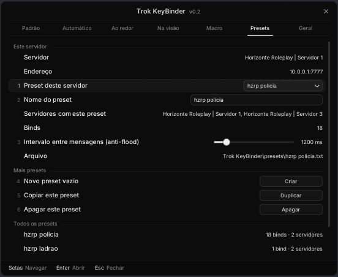

## Geral

| Opção | Padrão |
|---|---|
| Ligado | sim |
| Atalho do menu de binds | nenhum |
| Tamanho do círculo | 100% |
| Segurar por | 2000 ms |
| 2x seguidas: até | 350 ms |
| Na visão: distância | 25 m |
| Bolinha no jogador da mira | sim |
| Com alguém na mira, o atalho abre | lista no jogador |

## A pasta

Tudo fica em `Trok KeyBinder\`, ao lado do `.asi`, em UTF-8:

| Arquivo | O que tem |
|---|---|
| `geral.txt` | as opções do Geral e qual preset cada servidor usa |
| `presets\<nome do preset>.txt` | um arquivo por preset, com as binds dele |
| `presets\apagados\` | os presets apagados no menu (para recuperar, traga o arquivo de volta) |
| `Trok KeyBinder.log` | o log |

- **Passar um preset a alguém:** copie o arquivo dele. Quem recebe põe o arquivo em `presets\`, e ele entra no próximo `/trokbinder` (com outro nome, se já houver um igual).
- **Renomear o preset no menu** renomeia o arquivo.
- **A v0.1** guardava tudo em `Trok KeyBinder.txt`, ao lado do `.asi`. Na primeira vez, o mod passa esse arquivo para a pasta e deixa o antigo como `Trok KeyBinder.txt.antigo`.
- O mod só grava o arquivo que mudou (num `.tmp`, que depois troca de nome). Dá para editar com o jogo fechado.

## Compilar e testar

```
./build.sh            # dist/Trok KeyBinder.asi (MinGW i686)
test/run.sh           # Linux: motor, presets e as imagens do menu (test/out)
test/smoke/run.sh     # Wine 32 bits + Xvfb: o .asi num GTA e SA-MP de mentira
```

O kit da casa vem de `../trok-ui/asi`. Esta versão acrescentou ao kit:
- `Rows::Hotkey` (atalho com Ctrl/Shift/Alt);
- `Rows::Entry` (linha de lista com resumo e interruptor);
- `Rows::Note` (linha só de leitura, sem número);
- a largura dos campos de texto e o retângulo do botão do `Rows::Action`;
- o botão do meio e os laterais do mouse no `Rows::Hotkey`.

Os ícones: `tools/gen_icons.py <pasta com os SVG do Lucide> src/icons_data.h` (Lucide, licença ISC, © Lucide Icons and Contributors).

## Endereços

**SA-MP 0.3.7 R1** (SAMP-API):

| O quê | Endereço / campo |
|---|---|
| `CChat::AddEntry` (gancho para o gatilho do chat) | `0x64010` |
| `CInput::Send` | `0x65C60` |
| `CInput` aberto | `+0x14E0` |
| `CDialog` ativo | `+0x28` |
| Placar | `0x21A0B4` |
| `CGame` cursor | `+0x55` |
| `CNetGame` | endereço `+0x20`, nome `+0x121`, porta `+0x225`, estado `+0x3BD` |
| `CPlayerPool` | local `+0x04`/`+0x0A`/`+0x22`, remotos `+0x2E`/`+0xFDE` |
| `CLocalPlayer` | `+0x0C` ativo, `+0x10` morto |
| `CLabel::HasNoObstacles` (teste de parede) | `0x67530` |

**GTA SA 1.0 US** (gta-reversed):

| O quê | Endereço / campo |
|---|---|
| Jogador | `0xB7CD98` |
| `CPed` | vida `+0x540`, colete `+0x548`, estado `+0x530`, no veículo `+0x46D` bit 0, veículo `+0x58C`, armas `+0x5A0` (0x1C cada), slot `+0x718` |
| `CVehicle` | motorista `+0x460`, lataria `+0x4C0` |
| Interior (`CGame::currArea`) | `0xB72914` |
| Mouse (`CPad::NewMouseControllerState`) | `0xB73418`: meio `+2`, laterais `+5` e `+6` |
| `CSprite::CalcScreenCoors` | `0x70CE30` |
