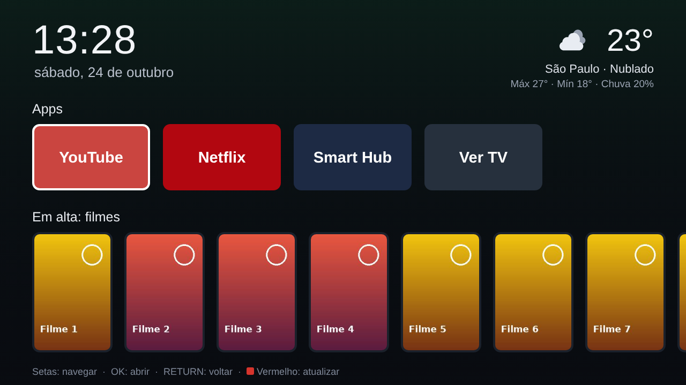

# Minha TV: tela inicial para a Samsung UN46F6400 (2013)

Uma tela limpa e rápida para a sua Samsung: relógio, clima, atalhos para os apps,
filmes e séries em alta e a previsão da semana. Sem anúncios, sem root e sem mexer no
sistema da TV.



## Por que não é igual ao dos vídeos

Os vídeos usam TVs LG (webOS), Android/Google TV ou Samsung de 2017 em diante (Tizen).
A sua é uma **Samsung série F de 2013**, que roda um sistema mais antigo, o **Orsay**.
O [Free My TV](https://github.com/simbasjungles/free-my-tv) avisa que não funciona nas
Samsung antes de 2017. Por isso este projeto é um app feito sob medida para a sua TV,
com o mesmo espírito.

**O que dá para fazer:**

- um app em tela cheia com relógio, clima, apps, filmes/séries em alta e previsão;
- abrir os apps da TV (YouTube, Netflix...) direto pelo Minha TV;
- ver detalhes de um filme e "onde assistir" no Brasil, com um botão para abrir o app.

**O que não dá, numa TV de 2013 sem root:**

- trocar a tela do Smart Hub ou fazer o app abrir sozinho quando a TV liga;
- voltar para o Minha TV quando você sai de outro app: a TV volta para o Smart Hub.

O Minha TV fica em *Smart Hub → Apps → Mais Apps*. Depois de aberto uma vez, ele aparece
nos apps recentes do Smart Hub.

## Como funciona

```
 PC (cabo de rede)                                    TV (Wi-Fi, mesmo roteador)
 ┌─────────────────────────┐   1. instala o app     ┌──────────────────────┐
 │ servidor/servidor.py    │ ─────────────────────► │ Smart Hub "develop"  │
 │  • monta o MinhaTV.zip  │   2. clima e filmes    │  └ app Minha TV      │
 │  • busca clima e TMDB   │ ◄───────────────────── │                      │
 └─────────────────────────┘                        └──────────────────────┘
```

A TV de 2013 nem sempre consegue acessar sites modernos (HTTPS novo), por isso o PC
busca o clima e os filmes e repassa para a TV. **Com o PC desligado, o app continua
abrindo**: o relógio e os apps funcionam, e o clima tenta ir direto ao Open-Meteo.

## Passo 1: baixar o projeto no PC

Com o Git:

```
git clone https://github.com/victortroquetti-cpu/t3.git
cd t3
git checkout claude/nice-babbage-ba1vo4
cd tv-samsung
```

Ou baixe o ZIP pelo GitHub (botão *Code → Download ZIP*, no branch `claude/nice-babbage-ba1vo4`)
e abra a pasta `tv-samsung`.

## Passo 2: ligar o servidor no PC

Você precisa do **Python 3** (gratuito).

- **Windows:** dê dois cliques em `INICIAR-WINDOWS.bat`. Se ele disser que não achou o
  Python, instale pelo [python.org](https://www.python.org/downloads/) (marque *Add
  python.exe to PATH*) ou rode `winget install Python.Python.3.12` no PowerShell.
  Quando o Windows perguntar sobre o firewall, **permita em redes privadas**.
- **macOS:** `./iniciar.sh` no Terminal.
- **Linux:** `sudo ./iniciar.sh` (a porta 80 pede administrador).

A janela mostra o **IP do PC** (algo como `192.168.0.10`). Anote esse número e **deixe a
janela aberta**.

Para ver a tela no navegador do PC antes de ir para a TV, abra `http://<IP do PC>/app/`.
Use as setas, Enter (OK), Backspace (RETURN) e a tecla R (botão vermelho).

## Passo 3: entrar como "develop" na TV

É o "modo desenvolvedor" das Samsung de 2013. Não muda nada no sistema e dá para
desfazer.

1. Aperte **MENU** no controle e vá em **Recursos Smart** (*Smart Features*).
2. Abra **Conta Samsung** e depois **Iniciar sessão** (*Log In*).
3. No e-mail, digite **`develop`**. Deixe a senha **em branco**.
4. Confirme e saia dos menus.

## Passo 4: instalar o app (sincronizar)

1. Aperte **SMART HUB** no controle e vá em **Apps**.
2. Embaixo, escolha **Mais Apps** (*More Apps*).
3. No canto de cima, à direita, abra **Opções** (*Options*).
4. Escolha **Configuração de IP** (*IP Setting*) e digite o IP do PC do passo 2.
5. Em **Opções** de novo, escolha **Iniciar sincronização de apps** (*Start App Sync*).

Na janela do servidor aparecem *"A TV pediu a lista de apps"* e depois *"A TV baixou o
app"*. A TV instala sozinha em alguns segundos.

> Os nomes dos menus podem variar um pouco conforme o idioma e a versão da TV.
> A sincronização substitui outros apps instalados pelo "develop". Os apps da loja
> Samsung (Netflix, YouTube...) não são afetados.

## Passo 5: abrir

**Smart Hub → Apps → Mais Apps → Minha TV.**

| Botão do controle | O que faz |
|---|---|
| Setas | Navegar |
| OK | Abrir o app, o filme ou o botão |
| RETURN | Fechar o detalhe do filme |
| EXIT | Sair do Minha TV |
| Vermelho (A) | Atualizar clima e filmes |
| INFO | Mostrar a versão e o IP do PC |
| Volume e mudo | Continuam com a TV |

## Personalizar

O servidor cria o arquivo `config.json` na primeira vez que roda:

```json
{
  "cidade": "São Paulo",
  "latitude": -23.5505,
  "longitude": -46.6333,
  "tmdb_chave": "",
  "tmdb_regiao": "BR",
  "apps": [
    { "nome": "YouTube", "id": "111299001912", "cor": "#c4302b" },
    { "nome": "Netflix", "id": "11101200001", "cor": "#b20710" }
  ]
}
```

- **Cidade:** troque o nome, a latitude e a longitude (o Google Maps mostra as duas ao
  clicar no mapa).
- **Filmes e séries em alta:** crie uma conta grátis no [TMDB](https://www.themoviedb.org/signup),
  vá em *Configurações → API*, peça uma chave e copie o **Token de leitura da API** (ou a
  *Chave da API*) para `tmdb_chave`. A chave é sua: fica só no seu PC e nunca vai para o
  GitHub (o `config.json` está no `.gitignore`).
- **Apps:** cada app da TV tem um ID. Os de YouTube e Netflix acima são os conhecidos para
  as Samsung antigas. Para incluir outros, diga quais apps aparecem no seu Smart Hub.

Mudou o `config.json`? Feche e abra o servidor de novo. A cidade e os apps mudam na
próxima vez que você abrir o Minha TV, **sem reinstalar**. Mudanças no visual ou no código
precisam de uma nova sincronização (passo 4, item 5).

## Se algo der errado

- **A sincronização falha ou a TV não acha o PC:**
  - O PC e a TV precisam estar no mesmo roteador. Rede de convidados não serve, nem um
    roteador que isola os aparelhos.
  - No Windows, a rede precisa estar como **Privada**, com o Python liberado no firewall.
  - Confira se o IP digitado na TV é o que a janela do servidor mostra, e se a janela
    continua aberta.
- **"Porta 80 em uso":** feche o programa que usa a porta (IIS, Skype antigo, outro
  servidor) e abra de novo.
- **O IP do PC mudou:** reserve o IP do PC no roteador, ou refaça o passo 4 com o IP novo.
- **O login "develop" não entra:** anote a mensagem exata da TV e me mande.
- **"Sem conexão com o PC" no topo do app:** o servidor está fechado ou o PC está desligado.
- **Os filmes não aparecem:** falta a chave do TMDB, a chave está errada, ou o PC está sem
  internet. A própria tela do app explica qual dos casos é.

## Desfazer tudo

1. No Smart Hub, selecione **Minha TV**, abra as opções (botão TOOLS ou segure OK) e
   escolha **Excluir**.
2. Saia da conta "develop": **MENU → Recursos Smart → Conta Samsung → Sair**.

Nada mais na TV foi alterado.

## Para quem vai mexer no código

| Arquivo | O que é |
|---|---|
| [`app/index.html`](app/index.html) | A página do app (1280x720) |
| [`app/js/home.js`](app/js/home.js) | A tela: linhas, foco, clima, detalhe dos filmes |
| [`app/js/tv.js`](app/js/tv.js) | O que é da TV: teclas, abrir apps, volume |
| [`app/js/dados.js`](app/js/dados.js) | Os pedidos ao servidor do PC |
| [`app/css/home.css`](app/css/home.css) | O visual |
| [`app/config.xml`](app/config.xml) | Nome, ícones e tamanho do app para o Smart Hub |
| [`servidor/servidor.py`](servidor/servidor.py) | O servidor do PC (instalação, clima, TMDB) |
| [`ferramentas/verificar.py`](ferramentas/verificar.py) | Confere se o app vai rodar na TV antiga |
| [`ferramentas/gerar_imagens.py`](ferramentas/gerar_imagens.py) | Desenha os ícones |

As regras da TV antiga (JavaScript ES5, CSS simples, memória curta) estão em
[`CLAUDE.md`](CLAUDE.md). Antes de sincronizar uma mudança, rode
`python ferramentas/verificar.py`.

## Créditos

- O caminho de instalação (conta "develop" e sincronização de apps) foi documentado pela
  comunidade SamyGO e por projetos como [White Raven](https://github.com/silentmurdock/whiteraven)
  e [SamsungTV_IPTV](https://github.com/oasenov/SamsungTV_IPTV).
- A ideia e o visual se inspiram no [Free My TV](https://github.com/simbasjungles/free-my-tv) (MIT).
- Clima: [Open-Meteo](https://open-meteo.com/) (CC BY 4.0).
- Filmes e séries: este produto usa a API do TMDB, mas não é endossado nem certificado pelo
  [TMDB](https://www.themoviedb.org/).
- Não é afiliado à Samsung nem aos serviços de streaming. Os nomes dos apps pertencem aos
  seus donos.
